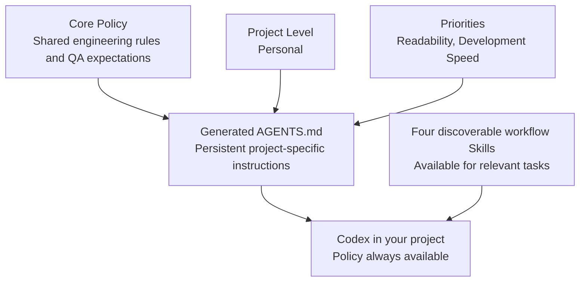

# Engineering Skillset

**A modular engineering methodology for AI-assisted software development.**

AI coding agents can generate working code quickly. Maintaining consistent
engineering quality across tasks and development sessions requires clear
expectations for architecture, implementation, verification, and project
continuity.

Engineering Skillset provides these expectations through a configurable Core
Policy and reusable workflow Skills for Codex.

Its guiding principles are:

- **Keep it simple:** Prefer readable, maintainable code and justified
  abstractions.
- **Respect scope:** Implement only authorized changes.
- **Design deliberately:** Establish responsibilities, interfaces, and
  important invariants before significant implementation.
- **Verify proportionately:** Apply appropriate checks at each development
  stage, with evidence-based acceptance.
- **Preserve continuity:** Record decisions, progress, limitations, and
  unresolved questions so work can continue reliably across sessions.

The methodology is experimental. Current evaluations have not established a
general quality or productivity advantage over baseline Codex.

This project is licensed under the Apache License, Version 2.0. See
[`LICENSE`](LICENSE) for the full license text.

## Quick start

Use the local installer from a checkout of this repository. The target
directory must already exist.

```bash
./scripts/install-policy.sh \
  --target /path/to/your/project \
  --level personal \
  --priority readability \
  --priority development-speed
```

After installation, invoke a workflow Skill by name when it fits the task. For
example, ask Codex to plan an API change without editing code:

```text
$software-design

Review the architecture of this Go API.
Propose the smallest change needed to support
idempotent job submission.

Do not modify the code yet.
```

## How it works

The installer composes a project policy from the Core Policy, one project
level, and selected priorities, then installs it as `AGENTS.md`. The four
workflow Skills are installed alongside it, where Codex can discover and use
them for relevant tasks. Automatic Skill activation is not guaranteed.



The Core Policy in [`AGENTS.md`](AGENTS.md) defines shared expectations for
authorized scope, simple and readable implementation, proportionate QA,
compositional testing, truthful evidence, and development continuity. Modules
add project-specific emphasis without replacing those guarantees.

Currently supported policy selections are:

- **Project level:** `personal`
- **Priorities:** `readability`, `development-speed`
- **Optional modules:** none currently available

The installer includes all four Skills. Codex can use them explicitly or when
contextually relevant, but automatic activation is not guaranteed:

- [`software-design`](.agents/skills/software-design/SKILL.md) — plan designs
  and nontrivial changes to existing systems.
- [`implementation-review`](.agents/skills/implementation-review/SKILL.md) —
  identify concrete implementation defects and justified corrections.
- [`verification-qa`](.agents/skills/verification-qa/SKILL.md) — select and
  assess proportionate tests and other checks.
- [`project-handover`](.agents/skills/project-handover/SKILL.md) — preserve
  verified project state, meaningful history, and deferred work.

## Configuration and reconfiguration

The installer uses the composer and installs the composed policy as the
target's `AGENTS.md`. It also installs the four Skills under
`.agents/skills/` and creates `.engineering-skillset-manifest` to track the
managed files and selected policy configuration.

Preview the plan without changing the target:

```bash
./scripts/install-policy.sh \
  --target /path/to/your/project \
  --level personal \
  --priority readability \
  --dry-run
```

The installer refuses to replace an existing unmanaged `AGENTS.md`, symbolic
links, modified managed files, or inconsistent installation metadata. It
preserves unrelated user files and Skills. Repeating an identical installation
does not rewrite managed files. To change an existing managed configuration,
repeat the desired selections with `--reconfigure`:

```bash
./scripts/install-policy.sh \
  --target /path/to/your/project \
  --level personal \
  --priority readability \
  --reconfigure
```

Reconfiguration requires the installer to verify ownership and file integrity.
Back up important project files before changing an existing installation and
review the result. The installer does not merge the policy with a user-authored
`AGENTS.md`; it only reconfigures an installation it can identify and verify.
See [installation metadata and recovery](docs/development/installation-metadata.md)
for ownership details and interrupted-operation guidance.

### Compose a policy without installing it

The composer writes a standalone policy to standard output by default:

```bash
./scripts/compose-policy.sh \
  --level personal \
  --priority readability \
  --priority development-speed
```

To write it to a new file, pass `--output PATH`. Existing output files are not
overwritten. The composer does not install Skills or modify a project.

### Remote bootstrap status

`scripts/bootstrap-policy.sh` can download an archive for a specified full
commit SHA, check it against a caller-provided SHA-256 digest, validate and
extract it in temporary storage, then delegate to the local installer. The
commit URL alone does not verify the downloaded bytes, and the digest must
come from a trusted channel. **Live GitHub download and trusted digest
provenance have not been established**, so remote bootstrap is not a qualified
release installation route. Use a trusted local checkout for the supported
installation procedure described above.

## Platform and dependencies

The supported and tested environment is GNU/Linux with Bash and GNU coreutils.
Local installation requires Bash, GNU coreutils (including `chmod`, `sha256sum`,
`sort`, `stat`, and the standard file utilities), and `cmp` from diffutils. Keep
them available on `PATH`. Optional remote bootstrap additionally requires
`curl` and GNU `tar`; it also uses `sha256sum` and `mktemp`.

Other platforms, including macOS and other Unix-like systems, have not been
qualified. The scripts use GNU-specific command behavior, so compatibility
with non-GNU toolchains is not established.

## Safety and limitations

- The installer manages the composed `AGENTS.md`, the four bundled Skill files,
  and its ownership manifest. Selective Skill removal and a dedicated uninstall
  command are not supported.
- Publication of the policy, Skills, and manifest uses separate filesystem
  operations and is not atomic as a set. Process interruption can leave an
  inconsistent installation; recovery steps are documented in the installation
  metadata guide.
- Concurrent modifications to target files during installation have not been
  qualified.
- Only the `personal` level and two priorities are currently implemented. No
  optional modules are available.
- Current evaluations have not established a general quality or productivity
  advantage over baseline Codex, or effectiveness in every project.

For current milestone status and the complete qualification record, see
[`ROADMAP.md`](ROADMAP.md). The design and evaluation documents are in
[`docs/architecture/`](docs/architecture/) and
[`docs/development/`](docs/development/).

## Development and tests

From the repository root, run the relevant Bash test scripts:

```bash
bash tests/compose-policy.sh
bash tests/install-policy.sh
bash tests/bootstrap-policy.sh
```

Check shell syntax and, when ShellCheck is installed, lint the scripts:

```bash
bash -n scripts/*.sh tests/*.sh
shellcheck scripts/*.sh tests/*.sh
```
